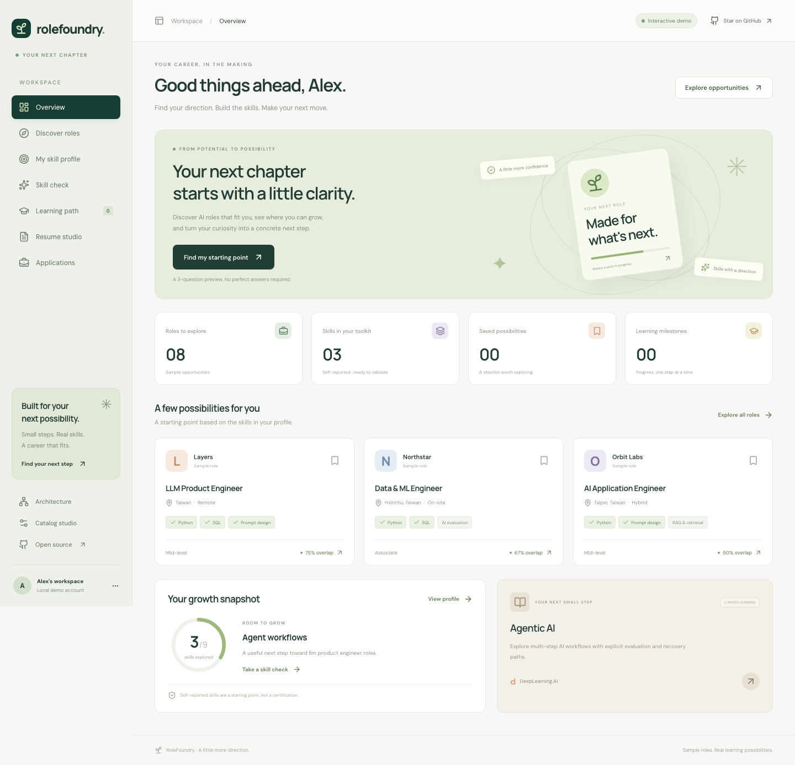
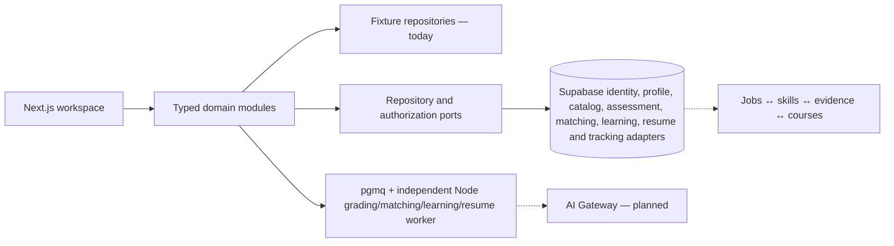

<div align="center">


# RoleFoundry

### Turn AI skills into your next role.

An open-source career workspace that connects **AI jobs → skill evidence → learning → your next move**.

[](https://github.com/jerry1022/rolefoundry/actions/workflows/ci.yml)
[](LICENSE)
[](https://nextjs.org/)
[](https://www.typescriptlang.org/)

[Explore the demo](https://jerry1022.github.io/rolefoundry/) · [Read the architecture](docs/HLD.md) · [Detailed designs](docs/design/README.md) · [Contribute](CONTRIBUTING.md)

[](https://vercel.com/new/clone?repository-url=https%3A%2F%2Fgithub.com%2Fjerry1022%2Frolefoundry&project-name=rolefoundry&repository-name=rolefoundry)

</div>



## A job board gives you a list. A career workspace gives you a next step.

Finding an interesting AI role is only the beginning. RoleFoundry helps you connect the requirements to your experience, notice where evidence is missing, and choose a useful course or practice task instead of collecting endless playlists.

**Discover a role. Understand the gap. Build something that proves progress.**

## Try it in two minutes

Requires **Node.js 24+**. No API key, account or database needed.

```bash
git clone https://github.com/jerry1022/rolefoundry.git
cd rolefoundry
npm ci
npm run dev
```

Open [localhost:3000](http://127.0.0.1:3000).

1. Explore a role and save it to your shortlist.
2. Adjust your skills, then try a three-question scenario check.
3. Choose a target role and explore relevant DeepLearning.AI resources.
4. Edit a sample resume and add a role to your application board.

Changes stay in your browser. Reset them from **Catalog studio**.

## What you can explore today

| Workspace | Working scaffold behavior |
| --- | --- |
| **Overview** | Recommended sample roles, growth snapshot and a next learning step |
| **Discover roles** | Ten specialization guides; optional published database catalog with source freshness, structured filters and private bookmarks; static fixtures remain clearly fictional |
| **My skill profile** | Account-backed preferences, private claims/references and immutable history when configured; static demo remains local |
| **Skill check** | Private versioned attempts, autosaved answers, durable fixed-choice grading and scenario evidence when configured; twelve-question local demo retained |
| **Matching & gaps** | Private versioned reports, explicit conditions, cited evidence, stale/deletion guards and durable rule-based ranking when configured; local demo retained |
| **Learning path** | Optional reviewed database catalog, private two-week plans, prerequisites, practice references and owner progress; six-link local demo retained |
| **Resume studio** | Optional private PDF/DOCX sources, confirmed facts/claim histories, grounded order proposals, individual acceptance and fixed-version PDF exports; local demo retained |
| **Applications** | Optional private cycles, manual stages, fixed resume references, notes, UTC follow-ups and event history; local board retained |
| **Catalog studio** | Optional administrator source/upload/feed/schedule/diff/publication workflows; fixture inspector and local reset retained |
| **Architecture** | An explorable overview of the planned service boundaries |
| **Skill dictionary** | Optional bilingual concepts, exact aliases, immutable snapshots, reviewed relations/merges and runtime skill choices |
| **Account & privacy** | Optional server-backed email OTP, invitations, consent, weekly allowance and admin controls; static demo stays local |

### Honest by default

This is a **functional product scaffold**, not a live recruiting service. Employers, openings and salaries are fictional. Course summaries and skill mappings are independent editorial metadata; course availability and pricing belong to the provider. RoleFoundry is not affiliated with DeepLearning.AI.

The public demo has no connected authentication or private backend. Configured server deployments now support [module 01 identity](docs/IDENTITY_SETUP.md) with Supabase Auth/PostgreSQL, invitations, consent and quotas. [Module 02](docs/PROFILE_SETUP.md) adds private profile/evidence persistence with explicit demo import. [Module 03](docs/CATALOG_SETUP.md) adds a published source-governed catalog and private bookmarks. [Module 04](docs/SKILL_DICTIONARY_SETUP.md) adds reviewed bilingual skill versions. [Module 05](docs/ASSESSMENT_SETUP.md) adds private assessments with a real pgmq/Node grading worker. [Module 06](docs/MATCHING_SETUP.md) adds versioned private matching and gap reports with deletion-safe citations. [Module 07](docs/LEARNING_SETUP.md) adds reviewed courses and private, budgeted learning plans with an actual worker. [Module 08](docs/RESUME_SETUP.md) adds private document workflows and fixed PDF exports with a real worker. [Module 09](docs/APPLICATIONS_SETUP.md) adds private manual tracking, history and follow-ups. [Module 10](docs/INGESTION_SETUP.md) adds authorized uploads, approved remote feeds, source schedules and audited publication review. No live feed is enabled by default. Model-assisted wording/analysis and application submission remain future work. The resume checklist and skill overlap are deterministic. Completing a course does **not** verify a skill; overlap does **not** predict hiring. Use sample information in the public demo.

### Run the identity foundation locally

With Docker running:

```bash
npm run identity:start
npx supabase migration up
npm run identity:invite -- developer@example.test
npm run identity:dev
```

Open `http://127.0.0.1:3200/account/`; receive your code in local Mailpit at port 54324. No cloud credentials are required. See the [identity setup guide](docs/IDENTITY_SETUP.md) for administrator bootstrap, hosted settings and `npm run identity:test`.

### Continue module development

Follow the [numbered delivery plan and dependency rules](docs/MODULE_DEVELOPMENT.md). Modules 01–10 implement identity, private profiles, published jobs, versioned bilingual skills, assessments, matching, reviewed learning, private resume workflows, manual application tracking and authorized ingestion. Required semantic matching and model-assisted wording remain integration gates with module 11. Module 10 adds [uploads, deployment-approved feeds, source schedules, administrator review forms, immutable previews and audited publication](docs/INGESTION_SETUP.md). Real metadata rights, matching hosted web/worker configuration and an owned deployment run remain release gates. The [AI Gateway plan](docs/design/11-ai-gateway.md#provider-candidates-and-fallback-policy) includes **LunaRoute as a fallback candidate**, pending capability/data-use evaluation and implementation; no automatic provider fallback is connected. The [complete design audit](docs/IMPLEMENTATION_AUDIT.md) retains every remaining acceptance gate. Each step updates its design, README and executable acceptance tests. Open PRs remain separate review gates.

[Administrator task/worker diagnostics](docs/OPERATIONS_SETUP.md) now provide audited metadata reads, task/event filters and pagination, queue/lease observations and real worker heartbeats in the private `/admin/` workspace. Replay, external alerts and full account export/deletion remain pending.

A local database recovery rehearsal is available with `npm run recovery:local`; `npm run recovery:local -- --verify-failure-cleanup` verifies cleanup after an intentional restore failure. See [scope, verification and remaining Storage/hosted gates](docs/OPERATIONS_RECOVERY.md).

The local helper also enables the database catalog at `/jobs/`, initially empty. Follow [catalog setup](docs/CATALOG_SETUP.md) to review/publish permitted source records. With identity configured, sign in at `/account/` and visit `/skills/` for the private profile. Existing local data is imported only after preview and explicit approval. See [profile setup and API](docs/PROFILE_SETUP.md).

## Architecture that can grow with the product



Today: **Next.js · React · TypeScript · Zod · Supabase Auth/PostgreSQL · CSS tokens · Lucide · Vitest · Playwright**.

The independent worker now consumes pgmq and executes fixed-choice grading, matching, learning plans, isolated resume workflows and authorized remote retrieval/catalog review planning with source schedules, leases, retries and atomic result publication. Run `npm run worker:local` alongside the configured web server; for assessment grading, author/review questions first using [assessment setup](docs/ASSESSMENT_SETUP.md). This scoring uses no external model or AI analysis allowance. Production extensions: **pgvector · schema-validated AI adapters**. Identity provider reservations and profile invalidation outboxes still await broader dispatch integration. Core profile, catalog, dictionary, assessment, matching, learning, resume, tracking and worker rules have no framework or database SDK dependency. The UI uses a replaceable client port, and request-scoped composition roots select adapters. [Architecture checks](scripts/check-boundaries.mjs) protect these boundaries. The architecture is a modular monolith, with explicit module ports rather than premature microservices.

```text
src/app/             Twelve pages, domain API routes and application layout
src/components/      Shared shell and interactive screens
src/lib/             Domain rules, schemas, fixtures and service ports
src/modules/identity Verified identity services and worker authorization guards
src/modules/profile  Domain schemas/ports/use cases, adapters and API composition
src/modules/skills   Bilingual dictionary, snapshots, alias/merge ports and adapters
src/modules/jobs     Published catalog, source policies and private bookmark ports/adapters
src/modules/assessment Private attempts, reviewed immutable questions and grading adapters
src/modules/matching Sealed inputs, source-grounded rules, private reports and deletion guards
src/modules/learning Reviewed courses, budgeted planner, private progress and replaceable gap adapter
src/modules/resume   Private sources, confirmed facts/claims, grounded revisions and fixed PDF exports
src/modules/tasks    Queue/handler ports, lease-aware engine and Supabase adapter
src/modules/platform Safe application errors and bounded HTTP helpers
src/modules/applications Private cycles, source snapshots, fixed resume links, event history and UTC follow-ups
src/modules/ingestion Authorized uploads/approved feeds/source schedules and reviewed publication through replaceable ports
supabase/            Identity/profile/catalog/dictionary/assessment/matching/learning/resume/tracking migrations, owner RLS and local OTP templates
apps/worker/         Independent queue consumer and explicit dry-run example
docs/                HLD, 13 module designs, API, data model and deployment
tests/               Domain tests and browser journeys
.github/workflows/   CI and static demo deployment
```

## Design documentation

- [Configuration status, automatic local setup and hosted handoff](docs/CONFIGURATION.md)

- [Original AI career classifications and learning pathways](docs/CAREER_PATHS.md)

- [Integrated product plan](ai-career-platform-plan.md)
- [High-level design](docs/HLD.md)
- [All 13 detailed module designs](docs/design/README.md)
- [Implemented identity module and setup](docs/IDENTITY_SETUP.md)
- [Implemented profile/evidence module](docs/PROFILE_SETUP.md)
- [Published catalog, source governance and bookmarks](docs/CATALOG_SETUP.md)
- [Versioned bilingual skill dictionary](docs/SKILL_DICTIONARY_SETUP.md)
- [Private assessments and durable grading](docs/ASSESSMENT_SETUP.md)
- [Private matching and gap reports](docs/MATCHING_SETUP.md)
- [Reviewed courses, two-week plans and private progress](docs/LEARNING_SETUP.md)
- [Private resume sources, claim histories and fixed PDF exports](docs/RESUME_SETUP.md)
- [Private manual tracking, history and follow-ups](docs/APPLICATIONS_SETUP.md)
- [Ingestion upload/review workflow and remaining integration](docs/INGESTION_SETUP.md)
- [Complete design acceptance audit](docs/IMPLEMENTATION_AUDIT.md)
- [Incremental development and replaceable service boundaries](docs/MODULE_DEVELOPMENT.md)
- [Production API contract](docs/API.md) and [data model](docs/DATA_MODEL.md)
- [Career journey playbook](AI_CAREER_PLAN.md)
- [Deployment guide](docs/DEPLOYMENT.md) and [roadmap](docs/ROADMAP.md)

All documentation is in English. The initial production market is Taiwan; Traditional Chinese localization is planned.

## Development checks

```bash
npm run typecheck
npm test
npm run architecture:check
npm run build
npx playwright install chromium
npm run test:e2e
npm run worker:demo
```

`worker:demo` validates only a dry-run contract. `npm run worker:local` consumes the real local queue; `npm run identity:test` verifies private assessment/matching/learning/resume APIs, actual worker handlers, lease/retry recovery and owner isolation. Browser tests cover discovery, bookmarks, assessment evidence, learning progress, resume export, the tracker, reset and mobile navigation.

## Deploy your own

**Vercel:** use the Deploy button or import this repository as a Next.js project. Keep the default build settings and leave `STATIC_EXPORT` and `NEXT_PUBLIC_BASE_PATH` unset. No credentials are required for the scaffold. Vercel Hobby is limited to personal/non-commercial usage within its quotas; future commercial operation and external services require an appropriate plan.

**Static hosting:** `NEXT_PUBLIC_BASE_PATH=/rolefoundry npm run build:pages` creates `out/` for a project-path deployment. Use an empty base path on a root domain. A GitHub Pages workflow is included.

**Docker:** `docker build -t rolefoundry .` then `docker run --rm -p 3000:3000 rolefoundry`.

See [deployment details](docs/DEPLOYMENT.md). The long-running worker uses `Dockerfile.worker` or `npm run worker:start` and is deployed separately from Vercel Functions; see [worker setup](docs/ASSESSMENT_SETUP.md).

## Build the next chapter with us

The next milestones are authorized live source adapters, calibrated assessments, reviewed learning content, production operations and model-assisted fact-preserving wording. Contributions to accessibility, source quality, assessment calibration and Traditional Chinese localization are especially welcome.

Read [CONTRIBUTING](CONTRIBUTING.md), open a focused issue, or pick a clearly scoped improvement from the [roadmap](docs/ROADMAP.md). Please do not contribute scraped personal data, copied course content or fabricated job listings presented as live openings.

If this direction is useful to you, **star the repository** to follow its progress and share it with someone building their next chapter in AI.

## License

[MIT](LICENSE) © Jerry Huang. Third-party courses and brands remain the property of their owners. The software license does not grant rights to external course content or job listings.
