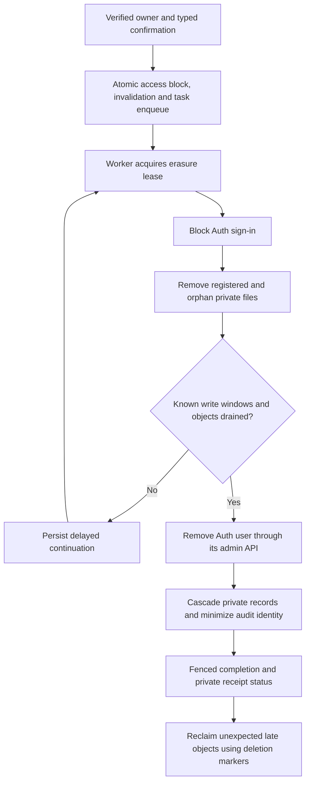

# Self-service live account deletion

## Delivered behavior

An active, verified owner can request permanent removal from `/account/` by typing **DELETE**. The request transaction cancels ordinary work, marks the profile inactive, releases unstarted provider reservations, invalidates stored account archives, schedules file cleanup and enqueues the erasure task. Private APIs and RLS reject subsequent account access immediately. The server attempts global sign-out; the worker also blocks the Auth account before removing it. Previously issued JWTs do not regain application access while cleanup is pending.

This removes the sign-in account and retained **private** application records/files in the implemented stores. It does not withdraw shared reviewed catalog publications, recall downloaded copies, or erase immutable backups immediately. Shared authorship links lose their profile FK; free-form reasons in owner/subject identity audits and owner assessment/dictionary/course audits are minimized. Separate browser-local demo data remains under the browser user's control.

## Local setup and user flow

1. Follow [identity setup](IDENTITY_SETUP.md) and apply `20261114110000_account_deletion.sql` using the existing reviewed migration procedure. Existing Supabase settings and worker secrets are sufficient; no new external account, key or model call is needed.
2. Run the configured web server (`npm run identity:dev`) and the long-lived worker (`npm run worker:local`). The request is durable even if the worker is temporarily stopped; acceptance does not mean cleanup has already finished.
3. Download anything to retain through [private account exports](ACCOUNT_DATA_SETUP.md) **before** requesting deletion. Account archives are invalidated and removed with the account.
4. At `/account/`, type `DELETE` and choose **Permanently delete my account**. The page immediately switches from account controls to removal progress.
5. Choose **Save deletion receipt** before leaving. The receipt is a request UUID plus a random secret; it contains no account email or identity credential. A holder can observe that request's status, so keep it private. The secret is sent only in POST bodies, never in a URL or application log. The database retains its SHA-256 digest.
6. After closing/reopening the page, use **Check an existing deletion receipt** while signed out. Progress can be `queued`, `cleaning-files`, `removing-account`, `completed` or `needs-attention`. It never restores sign-in access. Temporary service failures retry automatically; `needs-attention` requires operator recovery.

The request ID and secret are generated before submission. If acceptance commits but the response is lost, retrying the same request/receipt safely returns its existing progress without creating another operation, including after sign-out. There is no cancellation/reactivation endpoint for an accepted erasure request.

## Execution and failure boundaries



The task uses the existing PGMQ/lease/heartbeat engine. A task-owned, service-only erasure grant binds task, accepted request and original subject. An unregistered `account.delete` task cannot execute, even for an active owner. Only registered erasure tasks can continue after their owner becomes inactive or its profile disappears; this grants no private reads, provider calls or other task kinds an exception.

`tasks.user_id` becomes nullable only for the erasure kind. A profile-delete trigger preserves registered erasure tasks and removes other owner tasks before FK actions, preserving their previous cascade behavior. Erasure intent/events/grants survive Auth/profile deletion. A crash after external Auth deletion can therefore reclaim the same task, observe an absent user idempotently and finish with a current token. Stale tokens cannot record completion.

File cleanup handles both private buckets, registered references and canonical owner-prefix objects missing from a registry. Existing write deadlines and a two-minute grace prevent premature cleanup of in-flight writes. Auth removal waits until references and object metadata have drained. Unexpected Storage ownership outside the canonical application prefix fails closed for operator review. A bounded late-object reaper continues to reclaim unexpected objects under completed deletion subjects without reactivating those accounts.

A handler with remaining cleanup persists queue visibility/retry time and returns a `deferred` outcome; the engine neither acknowledges nor fails that continuation. Infrastructure/timeouts for accepted erasure tasks use durable backoff from five seconds up to one hour and are not abandoned after the ordinary three-attempt ceiling. Crash reclamation is also persistent. The normal attempt limits for other task kinds remain unchanged. Authorization/schema/permanent-state failures stop for audited operator recovery. Diagnostics label accepted erasure history `until-complete` and flag at least three erasure retry events in 24 hours; these notices send no external alert.

## Administrator recovery

At `/admin/`, expand **Account deletion recovery** using a verified administrator session. Find a request from its task UUID, review the failed task in [operations diagnostics](OPERATIONS_SETUP.md), then resume the **existing** request with one enumerated recovery reason. This creates an audited new task/grant and preserves the old attempt; it does not reset a task row or initiate removal for another account. Completed or still-active tasks cannot be resumed this way. A local service operator can use the same guarded RPC when no application administrator remains:

```bash
npm run account:resume -- --request <accepted-request-uuid> --reason operator-reviewed
```

This command accepts only the owned loopback stack, reads the existing ignored local credential and prints no subject/secret. It can create a new attempt after Auth/profile removal; it cannot create an unrequested deletion.

Lookup/status DTOs expose request state/timestamps/retry counts, not subject IDs, contact hashes or receipt secrets. Members cannot invoke recovery; raw tables and worker helpers deny authenticated/anonymous access. No administrator role is transferred automatically when its owner deletes an account; existing administrator bootstrap remains an operator responsibility.

## Retention and restore safety

Completion clears the temporary contact hash and captured invitation IDs. Original redeemed invitations and pre-request OTP throttle entries are removed; newly created unrelated invitation records are not selected by email alone. Private records cascade, Auth removes credentials/sessions, and operational actor/subject FKs become nullable. Retained markers contain a pseudonymous subject UUID, request/task IDs, timestamps, hashed receipt and minimal coded events/retry metadata. These are **not anonymous**; the subject UUID remains necessary for late-file cleanup and deletion replay after restore. No automatic marker purge is implemented until an operator verifies compatible backup/retention policy.

For an owned local database, export only the minimal restore markers:

```bash
npm run account:ledger -- --output .local/deletion-ledger/ledger-2026-11-22.json
```

The command accepts only the project's loopback database, requires a private directory, creates a new mode-0600 file and never overwrites an existing path. It exports version/timestamp plus request ID, subject UUID and request/completion timestamps. It excludes receipt digests/secrets, contact hashes, application records and credentials. Store authoritative ledger copies outside the database backup and protect their confidentiality/integrity through the operator's backup system. The default local path remains on the same computer; exporting there does **not** establish off-host durability.

The retained marker also blocks activation/private access if the same erased UUID is reintroduced while the ledger is present. A backup predating deletion may lack that marker: importing a trusted post-backup ledger and reapplying erasures **before** reconnecting users/workers still needs an executable restore-overlay procedure. Off-host ledger delivery, retention reconciliation, clean-cluster/Storage-object restoration and representative hosted operations remain [explicit recovery gates](OPERATIONS_RECOVERY.md). A successful live deletion is not evidence that these gates are complete.

## Verification

`npm run identity:test -- tests/identity/account-deletion.integration.test.ts` exercises actual local GoTrue/PostgREST/PostgreSQL/Storage and the production Next build: owner intent/origin/receipt protection, raw/helper denial, full normal queue, immediate access refusal, write-window continuations, orphan/foreign/late files, account ZIP/private-record removal, contact/audit minimization, crash after Auth deletion, stale leases, repeated failures/crashes, administrator recovery, private ledger export and mobile receipt save/check. Core unit cases verify staged ordering, persisted deferral without acknowledgement, failure and cancellation. Existing domain/owner-deletion suites remain regression gates.

The screenshots are from synthetic accounts in the actual app: [mobile removal progress](assets/account-deletion-mobile.png) and [mobile administrator recovery](assets/account-deletion-admin-mobile.png). Hosted configuration, external backup erasure and deleted data already held by an external recipient are outside this local evidence.
