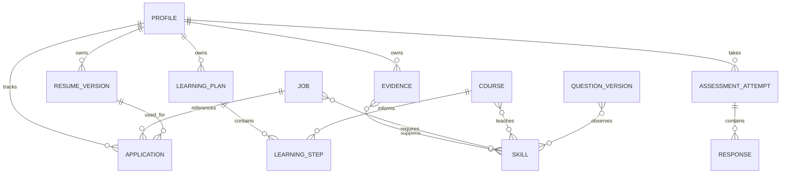

# Data model

**Status:** module 01 has an executable Supabase migration for identity, consent, quota policy, reservation/task outbox and audit records. Module 02 adds executable profile/evidence/version/link/claim/portfolio/outbox tables and a minimal canonical skill registry; module 03 adds sources, companies, canonical jobs/versions, source/requirement/skill links, catalog revisions/audit and private bookmark revisions/snapshots. Module 04 adds bilingual concepts, aliases, DAG relations, track mappings, dictionary snapshots/audit/outbox and historical-safe canonical projections. Module 05 adds immutable question/rubric versions, separate review publications, owner attempts/items/responses/results, general tasks/events and assessment audit with transactional pgmq dispatch. Module 06 adds immutable matching input snapshots, ranked results/gaps, evidence-version reference links and audit, with atomic deletion purge and freshness-checked RPC reads. Module 07 adds executable provider/source policy associations, course catalog state, immutable versions/skill links/prerequisites/URL identity/audit, owner learning plans/evidence references/steps, independent course progress/revisions and practice submissions. Module 08 adds private source documents, immutable confirmed versions, source-claim links, revision proposals, fixed-version exports, expiring download permits, registered-object cleanup and resume audit. Module 11 adds content-free AI gateway records (reviewed recipients, results/attempts, provider slots and token reservations); `consent_policies` is now the purpose registry referenced by quota, task and reservation tables. Optional AI fields record tie ordering on `match_runs` and wording suggestions on `revision_proposals`, and opt-in course link observations add host/check tables. Other career-domain tables below remain design only. See [profile setup](PROFILE_SETUP.md). See [identity setup](IDENTITY_SETUP.md); no hosted Supabase project is configured automatically.

## Ownership and groups

| Group | Tables | Access |
| --- | --- | --- |
| Identity | profiles, invitations, consent_policies (purpose registry), consents, quota_policies, identity_tasks, usage_reservations | Owner/server; invitations, roles and policies admin-controlled |
| Preferences | career_preferences, skill_claims | Owner only |
| Dictionary | skills, skill_aliases, skill_relations, track_skills, dictionary_versions | Published read; admin write |
| Jobs | companies, jobs, job_versions, job_sources, job_requirements, job_skill_links | Published read; reviewed admin write |
| Evidence | evidence, evidence_versions, evidence_skill_links, portfolio_references | Owner only; scored sources server-authored |
| Assessments | question_versions, question_publications, rubric_versions, assessment_audit, assessment_attempts, attempt_items, responses, assessment_results | Questions server-owned; attempts owner-scoped |
| Learning | course_providers, course_source_providers, course_catalog_state, courses, course_versions, course_url_registry, course_skill_links, course_prerequisites, course_audit, course_link_hosts, course_link_checks, learning_plans, learning_plan_evidence, learning_steps, learning_progress_state, learning_progress, practice_submissions | Published courses; owner plans/progress |
| Resumes | resume_documents, resume_versions, resume_claim_links, revision_proposals (including `wording*`), resume_exports, resume_downloads, resume_storage_objects, resume_audit | Owner only; private storage references |
| Recommendations | match_runs (including `ranking_*`, `semantic_task_id`), match_run_evidence, match_results, gap_items, match_audit | Owner only; versioned inputs |
| AI Gateway | ai_recipient_approvals, gateway_results, gateway_attempts, gateway_provider_slots, gateway_token_reservations | Service-only; recipient approvals administrator-managed; no prompt/input/output content |
| Tracking | bookmarks, applications, application_events, follow_up_tasks | Owner only |
| Operations | sources, import_batches, source_records, review_items, tasks, audit_events | Restricted service/admin access; model-call records live in the AI Gateway tables |

## Main relationships

## Constraints

- Opaque IDs; UTC timestamps; explicit versions on mutable aggregate roots.
- Every private record has an owner reference and matching RLS policy. Child records inherit checks through their parent and cannot be reassigned arbitrarily.
- Unique source/external-job ID, unique owner/bookmark job, unique owner/task idempotency scope and unique normalized skill alias per locale.
- Canonical skills outlive label changes. Deprecate/redirect rather than deleting linked historical identifiers.
- Store mandatory/preferred requirements separately. Unknown salary, language or qualification information stays null/unknown.
- Resume/question/rubric/course versions referenced by reports are immutable. Recommendations keep the exact profile, catalog and recipe versions used.
- A completed course is learning progress. Only a separate evidence-producing event can add scenario or reviewed evidence.
- Queue payloads contain task IDs. Private document content remains in owner-scoped records/storage, not queue messages or generic logs.

## Derived data and indexes

Index publication/status, track, location, owner and foreign keys used by authorization checks. Add unique indexes for idempotency and source identity. Use pgvector only for derived embeddings with a recorded model version/dimension. Keep separate indexes during model upgrades. Rebuild derived embeddings and recommendation snapshots from authoritative records.

## Retention and deletion

Retiring a public job retains application title/source snapshots. Owner deletion invalidates tasks and removes resumes, private storage objects, responses, evidence, embeddings and derived reports. Minimize retained audit events. Document the backup retention window and test that restored systems replay deletion tombstones before serving restored personal data.

## Migration approach

Migrations in `supabase/migrations/` are additive and ordered by timestamp; each module added its owner-scoped tables with authorization tests first, then catalogs and evidence, then tasks. Later changes extend earlier functions by wrapping them (renaming the original to `*_base`) instead of copying their bodies. Use expand/migrate/contract changes so web and worker versions can overlap safely. Never run destructive schema changes automatically from an unreviewed pull request.

## Assessment publication and task authority

Question content and grading rubrics are immutable; review status is a separate record that only affects future selection. Attempt items retain their exact question/rubric/dictionary versions. Draft writes use the attempt revision. Submit seals answers and creates the task plus task-ID-only message in the same transaction. General `tasks` are independent of the earlier identity provider reservation ledger; fixed-choice grading consumes no provider reservation.

The grading transaction locks dictionary, owner, task and attempt, validates active ownership and sealed input, and rechecks the lease before publishing. Scenario evidence, result and terminal task state commit atomically. Archive follows commit, so redelivery can safely observe success. Member table grants exclude bank content and lease tokens. See [assessment storage and worker contracts](ASSESSMENT_SETUP.md).

## Matching derived-content deletion

`match_run_evidence` references the exact source `evidence_versions` with cascading deletion. A matching-owned link-deletion trigger erases the run input and results/gaps and cancels pending work in the same transaction. Ordinary version edits preserve historical reports but mark them stale. Session roles have no raw matching-table read grants: owner RPCs recheck ownership, freshness and source availability before returning report pages. Lock order and source-projection boundaries are documented in [matching setup](MATCHING_SETUP.md).

## Learning version and deletion boundaries

A plan seals the exact target/evidence/profile/dictionary/catalog/course/progress inputs and a task-ID-only queue message atomically. Course content versions remain immutable across publication, retirement and dictionary merges; canonical joins are projections. Source rights and current review availability constrain new plans and publication. Learning-owned evidence-version FKs synchronously erase copied snapshots/output/generated steps and cancel pending work on evidence deletion. Independently authored private practice references survive with a null step link and remain individually deletable. Account deletion cascades them. Step/course progress never mutates profile evidence. See [learning persistence, locks and replacement contracts](LEARNING_SETUP.md).

## Resume source and derived-claim boundaries

Ready source metadata and task dispatch commit only after actual Storage size/hash verification. Confirmed versions and individual acceptance are immutable; dictionary history remains pinned while a separate canonical map guides new proposals. Confirmation appends source-bound unreviewed resume evidence; learning goals do not produce ability claims. Removing a source removes its claim histories, invoking existing synchronous matching/learning purge guards. Document deletion tombstones and erases personal rows immediately, while registered Storage paths survive owner deletion only for service-only leased cleanup. Export objects are tied to an exact immutable version and verified again before an owner-bound download. See [resume storage, locks and retry contracts](RESUME_SETUP.md).

## Manual application history

Module 09 implements `applications`, `application_events`, `follow_up_tasks`, `application_requests` and ID-only `application_audit`. Cycles retain minimal job snapshots after catalog deletion; a partial unique index permits one active owner/job cycle. Owner locks and revisions serialize edits, follow-ups and explicit new cycles. The selected resume is a live FK to an immutable owner version, not copied facts. Source deletion atomically nulls the link, advances revision and records removal. Events and requests are owner-private; deletion cascades event/follow-up content while request tombstones prevent replay resurrection. See [tracking data and replacement contracts](APPLICATIONS_SETUP.md).

## Authorized import review backend

Source policy/import-setting revisions invalidate stale authority. `import_batches` retains sanitized content and immutable processing context/output; ID-only `catalog.import` messages run the independent worker. `source_records` tracks source/external identity and the latest observed batch monotonically. `review_items` and immutable `ingestion_review_versions` retain original/rebased previews. Explicit producer publication writes `ingestion_publications` linking source row, batch, preview, reviewer and actual catalog version; `ingestion_decisions` retains idempotent receipts. Raw member grants are denied. Source/target/dictionary/lease guards reject stale or foreign publication. Feed execution/scheduling and the browser interface remain pending; see [ingestion contracts](INGESTION_SETUP.md).

Remote ingestion adds `ingestion_feed_settings` (approved definition ID/revision, independent feed capability, schedule owner/interval/due time and persisted provider wait/manual pause) and `ingestion_feed_runs` (immutable source/configuration/owner/task origin and sealed-batch reference). `import_batches.input_origin` is immutable `upload` or `feed`; each entry/rebase enforces that capability independently. Queue messages remain task IDs only. `catalog.fetch` atomically seals filtered input plus a `catalog.import` task, then succeeds. Once sealed, a run cannot replace its batch. Failure-side freshness updates preserve producer versions and historical references. A redelivered fetch reads the source wait before network access, covering a crash before queue backoff is updated. All new tables have RLS and no anonymous/member raw grants; schedule/worker helpers are service-only. [Contracts and limits](INGESTION_SETUP.md).

## Implemented operations diagnostics

`20261114104000_operations_observability.sql` adds `worker_instances` (process UUID, handler kinds, lease/concurrency, reported state and timestamps) and `operations_audit` (actor FK with deletion minimization, action, optional task UUID, timestamp). Both have RLS enabled and no authenticated/anonymous raw-table grants. Service writes are bounded by the presence RPC; current-administrator read functions produce minimized task/event/worker summaries and write an audit entry in the same transaction.

The registry cap is 1,000 records; reports opportunistically remove records unseen for 30 days or stopped for seven days. Reads opportunistically remove audits older than 90 days. Worker observations expire after 45 seconds without changing authoritative task state. See [lifecycle, DTO minimization and retention limits](OPERATIONS_SETUP.md). This separate audit stream complements existing domain-specific audit tables; it does not replace them with the future generic `audit_events` target.

## Implemented private account exports

`20261114105000_account_exports.sql` adds owner-scoped `account_exports` (sealed JSON pending execution, task, bounded idempotency, artifact metadata, expiry/invalidation) and service-only `account_export_objects` (reference, write window, purge deadline and cleanup lease). Both enable RLS and deny authenticated/anonymous raw access. Authenticated RPCs are limited to owner request/list/access/removal; snapshot and execution helpers remain service-only. The migration adds `account.export` to the task/operations kind contracts and creates a private ZIP bucket with no browser Storage policy.

Publication clears the sealed database payload after a verified private artifact is recorded. Privacy deletion/deactivation cancels in-flight publication and invalidates downloads before files are reclaimed. Cleanup references survive parent/owner deletion with nullable FKs. [Account data setup](ACCOUNT_DATA_SETUP.md) specifies the exact exported fields/groups, artifact/schema versions, bounds and opportunistic retention. Live account deletion and a guarded local restored-deletion overlay are implemented separately; hosted/off-host replay remains pending.

## Implemented live erasure and task continuation

`20261114110000_account_deletion.sql` adds `account_deletions` (accepted subject/request, hashed receipt, temporary contact/invitation references, current task and phase), `account_deletion_events` (coded audit metadata), and task-owned `task_erasure_grants` (accepted erasure capability and retry count). Raw access is service-only with RLS enabled. The public receipt RPC validates a high-entropy secret; administrator recovery is independently authorized in SQL.

Only erasure task owners may become null. A profile-delete trigger preserves registered erasure tasks and removes ordinary owner tasks before FK actions. The grant permits lease continuation after profile removal without authorizing another kind or private data read. Normal retry limits remain; erasure infrastructure retries persist with capped backoff and expose their policy in metadata. Source application records retain their original cascade semantics.

Completion clears contact hashes/captured invitation IDs, nulls operational profile links and retains a pseudonymous UUID ledger for late-object cleanup and restore replay. The [exact retention/restore boundaries](ACCOUNT_DELETION_SETUP.md) distinguish live removal from external backups and trusted ledger reapplication, which remain operational gates.

### Isolated recovery deletion overlay

`recovery_deletion_overlays` retains only run ID, normalized ledger digest, entry count, application time and SQL session role. Browser roles have no access; the service role can read but not directly write this audit. The service-only, ownership-guarded `recovery_apply_deletion_ledger` applies a bounded version-1 ledger atomically, preserves compatible request/receipt history, rejects subject/request conflicts, fences old work and creates a new erasure grant before removing restored private profiles. Canonical file references survive as nullable-parent cleanup records. Auth and Storage deletion continue through normal service adapters. No table or RPC authenticates an external ledger's provenance; production delivery/cutover remains an operator gate. See [recovery protocol and evidence](OPERATIONS_RECOVERY.md).

### Audited task recovery

`task_replays` binds one request UUID and old task to one new task, nullable administrator actor, coded reason and creation time. The previous-task FK cascades ordinary deletion; the new-task/actor FKs become null where necessary. Browser roles have no raw access, and the service role has read access only. Domain-owned private binding functions revalidate the original accepted input and update its current task pointer in the same transaction as enqueue/linkage/audit. The old task row and sealed input remain unchanged; assessment execution increments its existing revision while retaining sealed responses. Operational recovery links contain no copied private content and are excluded from the owner archive format. See [recovery scope and retention](TASK_REPLAY_SETUP.md).

### Consolidated identity administration

The existing invitation/quota tables remain authoritative. New administrator-only functions return bounded minimized pages; no contact hash or user relationship is exposed by the invitation directory. Unused-invitation revocation sets its expiry under the row lock used for activation and records a coded identity audit event; used records conflict. No new account-offboarding authority or table editor is introduced. Quota read DTOs preserve bigint IDs as decimal strings. Shared UI/client ports and the independent directory service/store are specified in [administrator setup](ADMIN_WORKSPACE_SETUP.md).

### Invalidation delivery receipts

`invalidation_deliveries` references exactly one profile event or dictionary version and a fixed consumer. Unique event/consumer pairs, eligibility timestamps, retained attempts, fenced leases, completion and one safe error code support atomic bounded dispatch/retry. Profile references cascade on owner/event removal; no private content is copied. RLS and revoked raw grants protect every role. Only the three service-only claim/apply/retry RPCs expose opaque leases; consumer/task helpers remain private. Producer triggers and migration catch-up populate receipts. See [version comparisons, transaction/locking policy and retention](INVALIDATION_SETUP.md).

### Resource-aware task acquisition

The resource-reader migration adds a queue-message lookup index and private kind-to-resource mapping plus service-only `task_read_resources`; it creates no new table. The legacy task reader delegates to the same owner/erasure/retry/lease implementation. Queue/task metadata select eligible work before the normal pgmq conditional read, preserving paused-capacity messages and execution attempts. Per-instance resource counters live in the worker core; provider-wide durable admission is not introduced. See [scope and migration](WORKER_RESOURCE_SETUP.md).

## Consent purpose registry and AI gateway records

`20261114200000_consent_purpose_registry.sql` replaces hard-coded purpose checks: `quota_policies.feature`, `identity_tasks.feature` and `usage_reservations.feature` now reference `consent_policies(purpose)` by foreign key, and the identity functions check membership. It adds the `matching` purpose (policy `2026-11-24`, default five per UTC week) beside `assessment` and `resume`; `20261114220000_consent_recipient_wording.sql` moves those two to version `2026-11-24` with recipient-based wording, so earlier grants require renewed consent.

`20261114190000_gateway_authority.sql` adds `ai_recipient_approvals` (purpose FK to `consent_policies`, policy version, recipient, reason, approver; empty by default and bound to a consent version), `gateway_results` (one row per identity task: purpose, state, code, template/input versions, provider/model, tokens, latency) and ordered `gateway_attempts` (provider, configured/reported model, phase, kind, outcome, fallback reason, latency, tokens). Results cascade with the identity task and its owner. `20261114240000_gateway_provider_slots.sql` adds leased `gateway_provider_slots` (provider, slot, token, expiry) and `20261114250000_gateway_provider_budgets.sql` adds `gateway_token_reservations` (provider, estimate, settled actual, time; pruned after two days). No gateway table stores prompt, input or output text. All have RLS and no client grants; only service RPCs (`gateway_admit`, `gateway_current`, `gateway_record`, `gateway_slot_acquire`/`gateway_slot_release`, `gateway_budget_reserve`/`gateway_budget_settle`) and audited administrator recipient functions reach them. See [AI gateway setup](AI_GATEWAY_SETUP.md).

`20261114210000_semantic_matching.sql` adds `match_runs.ranking_recipe` (`rules-v1` or `rules-v1+semantic-rank-v1`), `ranking_state` (`not-requested`, `applied`, `fallback`), `ranking_code` and a unique nullable `semantic_task_id` identity-task FK; rule results and gaps are unchanged. `20261114230000_resume_wording.sql` adds `revision_proposals.wording` (JSON suggestions), `wording_state`, `wording_code` and `wording_task_id`; suggestions never modify confirmed versions and are erased with their proposal. See [semantic ordering](MATCHING_SETUP.md#optional-semantic-ordering) and [wording suggestions](RESUME_SETUP.md#optional-ai-wording-suggestions).

## Course link observations

`20261114180000_course_link_checks.sql` adds service-only `course_link_hosts` (hostname, next probe time, manual pause, revision) and `course_link_checks` (one row per course: checked version/revision, allowed hosts, lease, check times, reason category and HTTP status). No response body or final redirect URL is stored. A failed observation can move a course to `uncertain` with a `course_audit` event; only human review restores availability. See [course link setup](COURSE_LINKS_SETUP.md).

## Aggregate operational telemetry

Migration `20261114170000_operations_telemetry.sql` adds `telemetry_http`: fixed family/method/status-class/latency-bucket primary key plus bigint sample/sum columns. It stores no subject, resource, timestamp, request ID, URL or content. Raw privileges are revoked from all client roles including service authority; only validated service RPCs record/read aggregates. `operations_snapshot_data` is private implementation detail; the administrator summary keeps its original authorization/audit wrapper. Counters have fixed cardinality and no subject-specific retention/deletion. Restores can reset observations; this is not an exact usage ledger. See [interpretation and release gates](TELEMETRY_SETUP.md).
