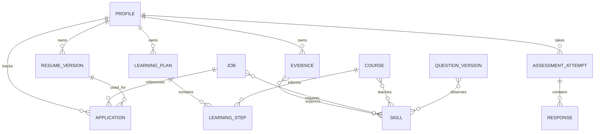

# Data model

**Status:** module 01 has an executable Supabase migration for identity, consent, quota policy, reservation/task outbox and audit records. Module 02 adds executable profile/evidence/version/link/claim/portfolio/outbox tables and a minimal canonical skill registry; module 03 adds sources, companies, canonical jobs/versions, source/requirement/skill links, catalog revisions/audit and private bookmark revisions/snapshots. Module 04 adds bilingual concepts, aliases, DAG relations, track mappings, dictionary snapshots/audit/outbox and historical-safe canonical projections. Module 05 adds immutable question/rubric versions, separate review publications, owner attempts/items/responses/results, general tasks/events and assessment audit with transactional pgmq dispatch. Module 06 adds immutable matching input snapshots, ranked results/gaps, evidence-version reference links and audit, with atomic deletion purge and freshness-checked RPC reads. Module 07 adds executable provider/source policy associations, course catalog state, immutable versions/skill links/prerequisites/URL identity/audit, owner learning plans/evidence references/steps, independent course progress/revisions and practice submissions. Module 08 adds private source documents, immutable confirmed versions, source-claim links, revision proposals, fixed-version exports, expiring download permits, registered-object cleanup and resume audit. Other career-domain tables below remain design only. See [profile setup](PROFILE_SETUP.md). See [identity setup](IDENTITY_SETUP.md); no hosted Supabase project is configured automatically.

## Ownership and groups

| Group | Tables | Access |
| --- | --- | --- |
| Identity | profiles, invitations, consents, usage_reservations | Owner/server; invitations and roles admin-controlled |
| Preferences | career_preferences, skill_claims | Owner only |
| Dictionary | skills, skill_aliases, skill_relations, track_skills, dictionary_versions | Published read; admin write |
| Jobs | companies, jobs, job_versions, job_sources, job_requirements, job_skill_links | Published read; reviewed admin write |
| Evidence | evidence, evidence_versions, evidence_skill_links, portfolio_references | Owner only; scored sources server-authored |
| Assessments | question_versions, question_publications, rubric_versions, assessment_audit, assessment_attempts, attempt_items, responses, assessment_results | Questions server-owned; attempts owner-scoped |
| Learning | course_providers, course_source_providers, course_catalog_state, courses, course_versions, course_url_registry, course_skill_links, course_prerequisites, course_audit, learning_plans, learning_plan_evidence, learning_steps, learning_progress_state, learning_progress, practice_submissions | Published courses; owner plans/progress |
| Resumes | resume_documents, resume_versions, resume_claim_links, revision_proposals, resume_exports, resume_downloads, resume_storage_objects, resume_audit | Owner only; private storage references |
| Recommendations | match_runs, match_run_evidence, match_results, gap_items, match_audit | Owner only; versioned inputs |
| Tracking | bookmarks, applications, application_events, follow_up_tasks | Owner only |
| Operations | sources, import_batches, source_records, review_items, tasks, audit_events, ai_requests | Restricted service/admin access |

## Main relationships

## Constraints

- Opaque IDs; UTC timestamps; explicit versions on mutable aggregate roots.
- Every private record has an owner reference and matching RLS policy. Child records inherit checks through their parent and cannot be reassigned arbitrarily.
- Unique source/external-job ID, unique owner/bookmark job, unique owner/task idempotency scope and unique normalized skill alias per locale.
- Canonical skills outlive label changes. Deprecate/redirect rather than deleting linked historical identifiers.
- Store mandatory/preferred requirements separately. Unknown salary, language or qualification information stays null/unknown.
- Resume/question/rubric/course versions referenced by reports are immutable. Recommendations keep the exact profile, catalog and recipe versions used.
- A completed course is learning progress. Only a separate evidence-producing event can add scenario or reviewed evidence.
- Queue payloads contain task IDs. Private document content remains in owner-scoped records/storage, not queue messages or generic logs.

## Derived data and indexes

Index publication/status, track, location, owner and foreign keys used by authorization checks. Add unique indexes for idempotency and source identity. Use pgvector only for derived embeddings with a recorded model version/dimension. Keep separate indexes during model upgrades. Rebuild derived embeddings and recommendation snapshots from authoritative records.

## Retention and deletion

Retiring a public job retains application title/source snapshots. Owner deletion invalidates tasks and removes resumes, private storage objects, responses, evidence, embeddings and derived reports. Minimize retained audit events. Document the backup retention window and test that restored systems replay deletion tombstones before serving restored personal data.

## Migration approach

Create migrations only when production persistence begins. Start with owner-scoped tables and authorization tests, then catalogs and evidence, then tasks. Use expand/migrate/contract changes so web and worker versions can overlap safely. Never run destructive schema changes automatically from an unreviewed pull request.

## Assessment publication and task authority

Question content and grading rubrics are immutable; review status is a separate record that only affects future selection. Attempt items retain their exact question/rubric/dictionary versions. Draft writes use the attempt revision. Submit seals answers and creates the task plus task-ID-only message in the same transaction. General `tasks` are independent of the earlier identity provider reservation ledger; fixed-choice grading consumes no provider reservation.

The grading transaction locks dictionary, owner, task and attempt, validates active ownership and sealed input, and rechecks the lease before publishing. Scenario evidence, result and terminal task state commit atomically. Archive follows commit, so redelivery can safely observe success. Member table grants exclude bank content and lease tokens. See [assessment storage and worker contracts](ASSESSMENT_SETUP.md).

## Matching derived-content deletion

`match_run_evidence` references the exact source `evidence_versions` with cascading deletion. A matching-owned link-deletion trigger erases the run input and results/gaps and cancels pending work in the same transaction. Ordinary version edits preserve historical reports but mark them stale. Session roles have no raw matching-table read grants: owner RPCs recheck ownership, freshness and source availability before returning report pages. Lock order and source-projection boundaries are documented in [matching setup](MATCHING_SETUP.md).

## Learning version and deletion boundaries

A plan seals the exact target/evidence/profile/dictionary/catalog/course/progress inputs and a task-ID-only queue message atomically. Course content versions remain immutable across publication, retirement and dictionary merges; canonical joins are projections. Source rights and current review availability constrain new plans and publication. Learning-owned evidence-version FKs synchronously erase copied snapshots/output/generated steps and cancel pending work on evidence deletion. Independently authored private practice references survive with a null step link and remain individually deletable. Account deletion cascades them. Step/course progress never mutates profile evidence. See [learning persistence, locks and replacement contracts](LEARNING_SETUP.md).

## Resume source and derived-claim boundaries

Ready source metadata and task dispatch commit only after actual Storage size/hash verification. Confirmed versions and individual acceptance are immutable; dictionary history remains pinned while a separate canonical map guides new proposals. Confirmation appends source-bound unreviewed resume evidence; learning goals do not produce ability claims. Removing a source removes its claim histories, invoking existing synchronous matching/learning purge guards. Document deletion tombstones and erases personal rows immediately, while registered Storage paths survive owner deletion only for service-only leased cleanup. Export objects are tied to an exact immutable version and verified again before an owner-bound download. See [resume storage, locks and retry contracts](RESUME_SETUP.md).

## Manual application history

Module 09 implements `applications`, `application_events`, `follow_up_tasks`, `application_requests` and ID-only `application_audit`. Cycles retain minimal job snapshots after catalog deletion; a partial unique index permits one active owner/job cycle. Owner locks and revisions serialize edits, follow-ups and explicit new cycles. The selected resume is a live FK to an immutable owner version, not copied facts. Source deletion atomically nulls the link, advances revision and records removal. Events and requests are owner-private; deletion cascades event/follow-up content while request tombstones prevent replay resurrection. See [tracking data and replacement contracts](APPLICATIONS_SETUP.md).

## Authorized import review backend

Source policy/import-setting revisions invalidate stale authority. `import_batches` retains sanitized content and immutable processing context/output; ID-only `catalog.import` messages run the independent worker. `source_records` tracks source/external identity and the latest observed batch monotonically. `review_items` and immutable `ingestion_review_versions` retain original/rebased previews. Explicit producer publication writes `ingestion_publications` linking source row, batch, preview, reviewer and actual catalog version; `ingestion_decisions` retains idempotent receipts. Raw member grants are denied. Source/target/dictionary/lease guards reject stale or foreign publication. Feed execution/scheduling and the browser interface remain pending; see [ingestion contracts](INGESTION_SETUP.md).

Remote ingestion adds `ingestion_feed_settings` (approved definition ID/revision, independent feed capability, schedule owner/interval/due time and persisted provider wait/manual pause) and `ingestion_feed_runs` (immutable source/configuration/owner/task origin and sealed-batch reference). `import_batches.input_origin` is immutable `upload` or `feed`; each entry/rebase enforces that capability independently. Queue messages remain task IDs only. `catalog.fetch` atomically seals filtered input plus a `catalog.import` task, then succeeds. Once sealed, a run cannot replace its batch. Failure-side freshness updates preserve producer versions and historical references. A redelivered fetch reads the source wait before network access, covering a crash before queue backoff is updated. All new tables have RLS and no anonymous/member raw grants; schedule/worker helpers are service-only. [Contracts and limits](INGESTION_SETUP.md).

## Implemented operations diagnostics

`20261114104000_operations_observability.sql` adds `worker_instances` (process UUID, handler kinds, lease/concurrency, reported state and timestamps) and `operations_audit` (actor FK with deletion minimization, action, optional task UUID, timestamp). Both have RLS enabled and no authenticated/anonymous raw-table grants. Service writes are bounded by the presence RPC; current-administrator read functions produce minimized task/event/worker summaries and write an audit entry in the same transaction.

The registry cap is 1,000 records; reports opportunistically remove records unseen for 30 days or stopped for seven days. Reads opportunistically remove audits older than 90 days. Worker observations expire after 45 seconds without changing authoritative task state. See [lifecycle, DTO minimization and retention limits](OPERATIONS_SETUP.md). This separate audit stream complements existing domain-specific audit tables; it does not replace them with the future generic `audit_events` target.
