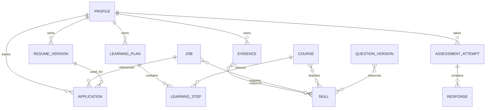

# Data model

**Status:** module 01 has an executable Supabase migration for identity, consent, quota policy, reservation/task outbox and audit records. Module 02 adds executable profile/evidence/version/link/claim/portfolio/outbox tables and a minimal canonical skill registry; module 03 adds sources, companies, canonical jobs/versions, source/requirement/skill links, catalog revisions/audit and private bookmark revisions/snapshots. Module 04 adds bilingual concepts, aliases, DAG relations, track mappings, dictionary snapshots/audit/outbox and historical-safe canonical projections. Module 05 adds immutable question/rubric versions, separate review publications, owner attempts/items/responses/results, general tasks/events and assessment audit with transactional pgmq dispatch. Other career-domain tables below remain design only. See [profile setup](PROFILE_SETUP.md). See [identity setup](IDENTITY_SETUP.md); no hosted Supabase project is configured automatically.

## Ownership and groups

| Group | Tables | Access |
| --- | --- | --- |
| Identity | profiles, invitations, consents, usage_reservations | Owner/server; invitations and roles admin-controlled |
| Preferences | career_preferences, skill_claims | Owner only |
| Dictionary | skills, skill_aliases, skill_relations, track_skills, dictionary_versions | Published read; admin write |
| Jobs | companies, jobs, job_versions, job_sources, job_requirements, job_skill_links | Published read; reviewed admin write |
| Evidence | evidence, evidence_versions, evidence_skill_links, portfolio_references | Owner only; scored sources server-authored |
| Assessments | question_versions, question_publications, rubric_versions, assessment_audit, assessment_attempts, attempt_items, responses, assessment_results | Questions server-owned; attempts owner-scoped |
| Learning | courses, course_versions, course_skill_links, course_prerequisites, learning_plans, learning_steps, learning_progress, practice_submissions | Published courses; owner plans/progress |
| Resumes | resume_documents, resume_versions, revision_proposals, resume_exports | Owner only; private storage references |
| Recommendations | match_runs, match_results, gap_items | Owner only; versioned inputs |
| Tracking | bookmarks, applications, application_events, follow_up_tasks | Owner only |
| Operations | sources, import_batches, source_records, review_items, tasks, audit_events, ai_requests | Restricted service/admin access |

## Main relationships

## Constraints

- Opaque IDs; UTC timestamps; explicit versions on mutable aggregate roots.
- Every private record has an owner reference and matching RLS policy. Child records inherit checks through their parent and cannot be reassigned arbitrarily.
- Unique source/external-job ID, unique owner/bookmark job, unique owner/task idempotency scope and unique normalized skill alias per locale.
- Canonical skills outlive label changes. Deprecate/redirect rather than deleting linked historical identifiers.
- Store mandatory/preferred requirements separately. Unknown salary, language or qualification information stays null/unknown.
- Resume/question/rubric/course versions referenced by reports are immutable. Recommendations keep the exact profile, catalog and recipe versions used.
- A completed course is learning progress. Only a separate evidence-producing event can add scenario or reviewed evidence.
- Queue payloads contain task IDs. Private document content remains in owner-scoped records/storage, not queue messages or generic logs.

## Derived data and indexes

Index publication/status, track, location, owner and foreign keys used by authorization checks. Add unique indexes for idempotency and source identity. Use pgvector only for derived embeddings with a recorded model version/dimension. Keep separate indexes during model upgrades. Rebuild derived embeddings and recommendation snapshots from authoritative records.

## Retention and deletion

Retiring a public job retains application title/source snapshots. Owner deletion invalidates tasks and removes resumes, private storage objects, responses, evidence, embeddings and derived reports. Minimize retained audit events. Document the backup retention window and test that restored systems replay deletion tombstones before serving restored personal data.

## Migration approach

Create migrations only when production persistence begins. Start with owner-scoped tables and authorization tests, then catalogs and evidence, then tasks. Use expand/migrate/contract changes so web and worker versions can overlap safely. Never run destructive schema changes automatically from an unreviewed pull request.

## Assessment publication and task authority

Question content and grading rubrics are immutable; review status is a separate record that only affects future selection. Attempt items retain their exact question/rubric/dictionary versions. Draft writes use the attempt revision. Submit seals answers and creates the task plus task-ID-only message in the same transaction. General `tasks` are independent of the earlier identity provider reservation ledger; fixed-choice grading consumes no provider reservation.

The grading transaction locks dictionary, owner, task and attempt, validates active ownership and sealed input, and rechecks the lease before publishing. Scenario evidence, result and terminal task state commit atomically. Archive follows commit, so redelivery can safely observe success. Member table grants exclude bank content and lease tokens. See [assessment storage and worker contracts](ASSESSMENT_SETUP.md).
