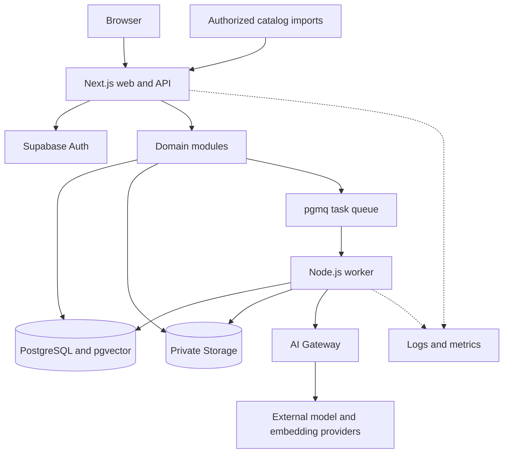

# RoleFoundry — High-Level Design

**Version:** 0.4 published catalog foundation · **Status:** career scaffold, server identity, private profile and catalog implemented; remaining production modules planned

## 1. Purpose and scope

RoleFoundry connects AI job discovery to evidence-based skills, gap analysis, curated DeepLearning.AI learning resources, resume improvement and application tracking. The initial production audience is Taiwan-based job seekers across engineering/data, product/strategy, marketing/operations and design/content. The first scaffold uses English throughout to make the project accessible to open-source contributors. Traditional Chinese localization is a production milestone.

The shared domain relationship is:

**Job requirements ↔ skill dictionary ↔ personal evidence ↔ assessments ↔ courses and practice.**

Job discovery must work before account creation or assessment. Completing a course never automatically verifies ability. A match score is a sorting aid, not a hiring probability. The platform does not make employer eligibility decisions.

## 2. Current executable system

The repository contains a Next.js App Router application with ten navigable pages, a shared shell, typed career fixtures and browser-local persistence. Module 01 adds real Supabase identity APIs, a database migration, consent and quota transactions, and worker guards. Module 02 adds private preferences, immutable evidence and reference-only invalidations through replaceable ports/adapters. Module 03 adds anonymous/SSR published job browsing, source governance and private bookmarks. Other domain ports remain contracts. The worker demo still does not consume a queue or execute analyses.

| Capability | Current state |
| --- | --- |
| Jobs | Optional persistent published catalog/SSR with source permissions/freshness and private bookmarks; static fixtures retained |
| Profile | Optional private preferences/evidence/history with optimistic revisions; static demo stays local |
| Assessment | Twelve fixed-answer scenarios across four tracks; three per attempt |
| Matching | Transparent self-reported skill overlap and missing-skill lists |
| Learning | Six official course links, editorial mappings, prerequisite-aware ranking |
| Resume | Local text editing, deterministic checklist, text export |
| Applications | Local manual board, stages and notes |
| Administration | Read-only fixture provenance inspector and confirmed local reset |
| Identity/database | Configurable Supabase Auth/PostgreSQL, email OTP, invitations, roles, consent, quotas and audit |
| Other career persistence/AI | Contracts and designs only; no live implementation |

## 3. Target architecture

Use a **modular monolith plus an independent background worker**. Domain modules are code boundaries, not separate microservices. Web and worker share versioned contracts and domain functions. PostgreSQL is the source of truth; embeddings and AI summaries are derived data.

No browser can call privileged database functions, provider APIs or worker credentials. Normal data operations must preserve the actor's identity. Administrative mutations require server-side authorization. The worker uses a restricted server identity and verifies task ownership and input versions.

See [module dependency rules](MODULE_DEVELOPMENT.md) for the enforced ports/adapters direction, request-scoped composition and replacement/upgrade contract. New modules keep domain rules independent of Next.js and provider SDKs.

## 4. Modules

Job discovery distinguishes four foundational assessment tracks from ten detailed job specializations. The original nine career directions and the retained design/content direction are documented in [career classifications](CAREER_PATHS.md). A category with no sample opening still presents its learning and evidence guide.

| Module | Ownership and principal output |
| --- | --- |
| Identity and access | Invitations, sessions, roles, consent and quotas |
| Profile and evidence | Career preferences, claims and traceable evidence |
| Job catalog and search | Normalized jobs, source links, publication and expiry |
| Skill dictionary | Canonical IDs, aliases and job-track relationships |
| Assessment | Question/rubric versions, attempts and scenario evidence |
| Matching and gaps | Condition checks, ranked results and explanations |
| Courses and learning | Reviewed course metadata, prerequisites and practice plans |
| Resume studio | Source versions, proposals, accepted changes and exports |
| Applications | User-recorded stages, dates, notes and next actions |
| Ingestion | Source authorization, batches, deduplication and review |
| AI Gateway | Provider boundary, structured validation, costs and versions |
| Task execution | Durable dispatch, leases, retries and idempotent results |

See [module designs](design/README.md) for interfaces and failure semantics.

## 5. Technology stack

| Layer | Scaffold | Production direction |
| --- | --- | --- |
| Language | TypeScript | Shared across web, domain and worker |
| Web | Next.js App Router, React | Server-render public catalog; private authenticated workspace |
| Styling | CSS tokens and responsive components, Lucide icons | Keep the existing design system; add localization without replacing components |
| Validation | Zod | Validate requests, persisted records and AI outputs |
| Storage | Browser-local demo; Supabase identity, profile and published catalog records | Extend PostgreSQL and private Storage to the other domains |
| Search | Deterministic in-memory filters | SQL predicates, skill aliases and pgvector reranking |
| Tasks | Dry-run contract | Supabase Queues/pgmq with a Node worker |
| AI | No provider connected | Gateway adapter selected through a fixed evaluation set |
| Documents | Plain-text draft/export | Isolated PDF.js/Mammoth parsing and controlled PDF rendering |
| Checks | TypeScript, Vitest, Playwright | Add database authorization, contract and integration tests |
| Build | npm lockfile, Node 24, Next.js | Reproducible CI; standard Next deployment or Docker |

The scaffold intentionally uses npm and CSS rather than adding a monorepo orchestrator or a utility-CSS framework before they are needed. The target service boundaries remain unchanged.

## 6. Critical flows

### Resume to evidence

Validate upload intent → store privately → create version and task atomically → parse in an isolated worker → extract a schema-constrained draft → ask the owner to confirm → publish confirmed claims. An extraction never silently replaces confirmed facts. Scanned PDFs receive a clear unsupported-format path in the first production release.

### Assessment to recommendation

Create a versioned attempt → save answers → grade with fixed rules or a reviewed rubric → record scenario evidence → compare target requirements → persist ranked results with input versions. Unknown requirements and missing evidence remain explicit. Production responses never expose correct answers before submission.

### Gap to learning

Aggregate important gaps → retrieve reviewed course records → check prerequisites, difficulty and time budget → order manageable steps → attach a practice task → record user-reported progress → reevaluate new evidence. Course completion and capability remain separate events.

### Catalog import

Confirm source usage rights → normalize a batch → deduplicate by source ID and stable attributes → extract skills → queue human review → publish → recheck validity → retire expired records. A failed fetch does not prove that a job has closed.

## 7. API and task boundaries

Production REST endpoints use `/api/v1`. Implemented identity endpoints use `/api/v1/identity`; profile/evidence, public catalog and private bookmark APIs are also implemented; other domain APIs remain planned. Analysis reservations atomically create an identity task and durable outbox row. Task states are `queued`, `running`, `succeeded` and `failed`; the identity task resource is owner-scoped. Module 12 will connect the outbox to actual execution.

Persist the business record and queued message in one database transaction. Worker results use an idempotency key derived from owner, task type and input version. Visibility leases can expire, so handlers must tolerate redelivery. A provider request can be repeated after a crash; do not describe queue delivery as end-to-end exactly-once AI execution.

## 8. Deployment and scaling

The scaffold can run on Vercel as a standard Next.js project, or export static assets for GitHub Pages. Neither path deploys a production worker. Vercel Hobby is for personal/non-commercial usage within its limits; a commercial service needs a suitable plan.

The target system can use either Vercel for web plus a separately hosted container worker, or a Docker-based web/worker deployment. Supabase remains an external managed data plane. Choose nearby regions and separate development, staging and production credentials. Add worker replicas based on queue age and provider limits; scale web independently. Introduce a dedicated search engine only after measured relevance or latency problems justify it.

## 9. Security and operations

Use server authorization plus owner-based RLS for private records. Keep service credentials out of client bundles. Validate file size/type and parse in isolation. Treat job descriptions and documents as untrusted input, never as executable instructions. Obtain consent before sending minimized personal content to an external provider. Log IDs and timings instead of raw resumes or answers.

Deletion removes owned files, evidence, embeddings, derived analyses and queued tasks; backups age out under a documented retention policy. Observe API errors, queue age, task failures, provider cost, catalog freshness and link failures. Rehearse backup restoration before accepting real personal data.

## 10. Acceptance and non-goals

The scaffold is complete when all routes render, interactions survive reload, the domain tests pass, mobile pages fit the viewport, the production build succeeds, and the repository clearly labels its limitations. Production acceptance additionally requires auth/RLS tests, authorized feeds, reviewed rubrics, real provider evaluation, privacy controls and recovery tests.

Initial non-goals: automatic applications, employer candidate ranking, certification, remote code execution, course-content hosting, billing and Kubernetes.

## References

- [Next.js deployment](https://nextjs.org/docs/app/getting-started/deploying)
- [Supabase database](https://supabase.com/docs/guides/database/overview)
- [Supabase Queues](https://supabase.com/docs/guides/queues)
- [DeepLearning.AI catalog](https://www.deeplearning.ai/courses)
- [Vercel Hobby plan](https://vercel.com/docs/plans/hobby)
