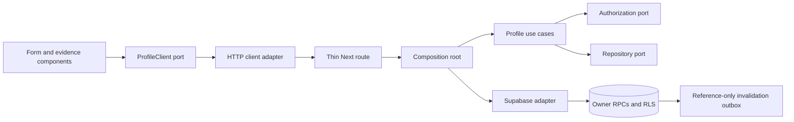

# Incremental module development

Implement the numbered designs in reviewable increments. Each module must have executable behavior, authorization/error handling, appropriate tests, an updated README and an accurate implementation status before its PR is considered ready. A completed contract is not a completed integration. Hosted deployment, source agreements, reviewed content and live-provider evaluation remain explicit release gates.

See the [complete requirement audit](IMPLEMENTATION_AUDIT.md) before claiming the overall goal complete.

## Delivery order and status

| Module | Status on this branch | Next acceptance gate |
| --- | --- | --- |
| 01 Identity/access | Implemented; base PR #1 | Hosted hook/SMTP/secrets and migration review |
| 02 Profile/evidence | Implemented on top of 01 | Review migration/API/UI and local integration results |
| 03 Jobs/search | Published catalog, source governance and private bookmarks implemented | Later dictionary/matching/ingestion/application integrations |
| 04 Skill dictionary | Bilingual snapshots, aliases, DAGs, admin review, historical-safe merges and runtime IDs implemented | Human mapping review and later report/version integration |
| 05 Assessment | Private immutable attempts/questions/rubrics, autosave and real deterministic grading/evidence implemented | Expert content review; short-answer AI calibration remains a future feature gate |
| 06 Matching | Versioned private reports, source-grounded rules, actual worker, conditions UI and atomic deletion purge implemented | Required semantic ranking integration with 11, plus human relevance/source review and recipe evaluation |
| 07 Courses/learning | Reviewed versioned catalog, private budgeted plans/prerequisites, actual worker and independent progress/practice implemented | Real authorized metadata population, editorial review and hosted operations |
| 08 Resume studio | Private sources, immutable confirmation/claims, grounded order proposals, fixed exports, actual worker and deletion cleanup implemented | Required model-assisted wording integration with 11; hosted containment/recovery and content review |
| 09 Tracking | Private versioned cycles, manual stages, immutable snapshots/events, fixed resume links and UTC follow-ups implemented | Hosted owner-isolation check; external submissions remain out of scope |
| 10 Ingestion | Authorized uploads/approved remote feeds/source schedules, actual worker, administrator review and immutable publication origins implemented; PR #10 | Real source rights/metadata, matching hosted definitions and owned deployment verification |
| 11 AI Gateway | Port only | Replaceable adapters, bounded execution, output/reference validation and evaluation |
| 12 Workers | Durable pgmq engine with assessment, matching, learning, resume and ingestion handlers implemented | Other domain handlers, provider reservations and invalidation outbox dispatch remain |
| 13 Operations | Identity admin controls only | Reviewed publication, recovery, deletion and telemetry |

Work follows the document sequence, but dependencies are explicit. Modules 05–08 may establish producers and deterministic domain rules before 11/12. They cannot be described as running asynchronous AI features until the gateway/worker integration passes its own checks. Module 02 seeded the initial foreign-key registry; module 04 now adds versioned administration and runtime IDs. Keep each new module's review focused; use a stacked PR base if its predecessor is still open, without silently merging it.

## Dependency rules

Use a modular monolith and ports/adapters. A module is not a separate deployment merely because it has a folder.

- `model.ts`: schemas, value types, safe domain errors and pure rules. No Next, database SDK, fixture or adapter imports.
- `ports.ts`: narrow interfaces owned by the consuming module. Prefer explicit operations to generic database access.
- `service.ts`: use cases and authorization through injected ports. No environment reads, SDK constructors or HTTP requests.
- `adapters/`: transport and persistence details. A database/provider replacement changes the adapter and composition root, while preserving the domain contract and its tests.
- `server.ts`: request-scoped wiring of verified identity, repository and use cases. Never share a user-specific repository between requests.
- `http.ts` and `route.ts`: bounded input parsing, same-origin checks, wire envelopes and safe error responses. Routes delegate to the service.
- UI forms/cards own drafts and presentation. The screen orchestrates an injected `ProfileClient`; only the entry component selects its concrete browser adapter. Components never import privileged clients.
- Cross-module mutations use public service ports or a deliberately granted database transaction boundary. Do not reach into another module's internal tables from presentation code.
- Keep existing demo APIs as compatibility exports where necessary; new production modules must not depend on the demo workspace shape.

`npm run architecture:check` enforces the profile/job/skill/assessment/task/matching/learning/resume/applications/ingestion core and corresponding UI import boundaries with the TypeScript parser. Extend its coverage when adding modules. It supplements behavior tests; it does not prove runtime security or transactional correctness.

## Dictionary concurrency and historical joins

Dictionary writes lock catalog, then dictionary exclusively. Link inserts use a shared dictionary lock. Merge updates canonical join projections without taking owner locks; immutable source IDs/content remain unchanged. Reports must record both dictionary and profile/input versions. See [dictionary integration](SKILL_DICTIONARY_SETUP.md).

## Version and deletion contracts

All module 02 mutations commit an aggregate revision with their change event under the same owner lock used by identity revocation/deactivation. Evidence edits append immutable versions. A write carries its last-read aggregate revision and, for evidence edits/deletion, the evidence version. Conflicts require a reload, never a silent overwrite.

Matching reports now store the profile revision and exact evidence versions, recheck source versions on publication/read and purge derived content atomically when a source evidence version is deleted. Learning plans also bind exact evidence/resource versions and atomically purge derived content on evidence deletion while retaining independent owner practice references. Resume proposals bind the confirmed source version, profile/catalog/dictionary/job versions and canonical projection; the current recipe uses independently confirmed resume facts, not copied profile evidence. Resume-derived evidence deletion purges matching/learning copies immediately. Future gateway recipes that consume additional evidence must bind its exact version IDs too. Check current inputs at publication and at read time. A changed revision makes a result stale. An `evidence.deleted` event contains the removed version IDs so dependent modules can remove reports/embeddings without retaining deleted content. Those modules must implement their purge/read guard before exposing derived personal data; module 02 cannot delete stores that do not yet exist. The durable event remains available for module 12 dispatch/retry; it is not a running event bus today.

Use additive migrations first. Do not rename canonical IDs or remove historical versions during an adapter upgrade. Run the same behavior/authorization suite against each replacement adapter before switching the composition root. Keep provider credentials and deployment-specific configuration outside the domain and browser.

## Configuration delivery

Configure and verify the settings that the available environment and authorized accounts support. For each remaining account-bound setting, document its exact location, purpose, required value or safe secret source, and a concrete verification step. Distinguish local configuration from hosted deployment evidence. Never describe an unapplied migration, disabled service, fixture or unconfigured provider as ready. Keep secrets out of tracked documentation and browser variables.
