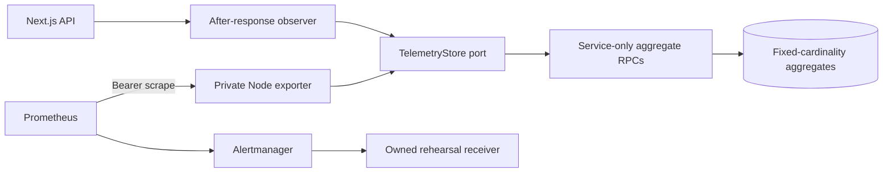

# Private operations telemetry

The optional telemetry module observes API handler latency/status, reads minimized queue/worker/outbox/catalog summaries and exposes OpenMetrics through an independent Node service. Prometheus and Alertmanager remain replaceable infrastructure; domain modules do not depend on either. Provider requests are not enabled by default; recorded [AI gateway](AI_GATEWAY_SETUP.md) attempts produce `rolefoundry_ai_*_24h{provider}` usage gauges. [Course link observations](COURSE_LINKS_SETUP.md) contribute `rolefoundry_course_links_*` gauges and two warning alerts.



## Local setup

With the project identity stack running, apply reviewed migrations, including `20261114170000_operations_telemetry.sql`:

```bash
npm run identity:start
npx supabase migration up
npm run identity:dev
```

The identity development/test helpers enable `ROLEFOUNDRY_TELEMETRY_ENABLED=true`. A normal server deployment defaults to disabled. API observation is scheduled with Next.js `after()` after the response; neither body nor URL is read. Failure of observation never retries or replaces the business operation. A lost callback can lose a measurement, so this is operational telemetry rather than a billing or compliance ledger.

In another terminal:

```bash
npm run metrics:local
```

This foreground helper uses the existing local Supabase credentials, binds only `127.0.0.1:9464`, and generates/reuses a 64-character random bearer token at `.local/observability/metrics-token`. Its directory is owner-only and the file is mode `0600`. It never prints the token or puts it in process arguments. Stop with Ctrl-C. For another free port, set `ROLEFOUNDRY_METRICS_PORT` identically for start and probe.

```bash
npm run metrics:probe
```

The probe reads the token in memory and prints only health/format metadata. It does not print the metrics payload or credential. The helper does not leave a hosted service running or enable monitoring in an unrelated project.

## Scrape, alert and recovery rehearsal

```bash
npm run metrics:rehearse
npm run metrics:rehearse -- --fail-after-start
```

The first command builds `Dockerfile.metrics`, checks real production Prometheus/Alertmanager configuration, runs the PromQL rule fixtures and verifies an authenticated scrape against the actual local database. It stops only its own exporter, observes an Alertmanager firing webhook at its own receiver, restarts the exporter and verifies a resolved webhook. All monitoring containers communicate on a dedicated internal network with no host-published ports. Only the exporter additionally joins this project's existing Supabase network.

The second command deliberately exits nonzero after startup to exercise cleanup. Both commands remove their uniquely named containers, internal network, image tag and temporary credential-bearing files. SIGINT/SIGTERM also enter cleanup. A private diagnostic log remains at `.local/metrics-rehearsal.log`; it is not a CI artifact. The project database and unrelated monitoring services are preserved. Local rehearsal uses an ephemeral TSDB with one-hour retention; it proves transport and recovery, not hosted durability.

Images in `ops/observability/images.json` pin the official Prometheus 3.13.5 LTS and Alertmanager 0.35.0 images by immutable digest. The rehearsal receiver accepts only its designated synthetic alert; it sends no email, chat or other external notifications. Production rules are routed to a sink during rehearsal. Four rule fixtures verify missing-worker persistence, idle-worker suppression and API-error minimum-volume behavior. The short outage test uses a separate three-second rule; production outage alerts require two minutes.

## Configuration and HTTP contract

| Setting | Process | Meaning |
| --- | --- | --- |
| `ROLEFOUNDRY_TELEMETRY_ENABLED` | Web | Exact `true` opts into observations; defaults disabled |
| `SUPABASE_URL`, `SUPABASE_SERVICE_ROLE_KEY` | Web/exporter | Existing server-only storage credentials; never public browser variables |
| `ROLEFOUNDRY_METRICS_TOKEN` | Exporter | Required independent 64-character lowercase hex bearer token |
| `ROLEFOUNDRY_METRICS_HOST` | Exporter | `127.0.0.1` default; explicit `0.0.0.0` for a protected container network |
| `ROLEFOUNDRY_METRICS_PORT` | Exporter | `9464` default; direct runtime permits `0` for owned tests |
| `ROLEFOUNDRY_METRICS_PRIVATE_NETWORK` | Exporter | Exact `true` allows HTTP to an explicitly private database gateway; otherwise HTTPS or loopback only |

`npm run metrics:start` runs the standalone configured service. `GET /metrics` requires the exact `Authorization: Bearer …` token, returns `Cache-Control: no-store` and OpenMetrics 1.0 content type with a final `# EOF`. Cookie authentication is rejected. Missing/wrong authentication returns `401`; authenticated non-GET returns `405`; other paths/query strings return `404`. An unavailable/invalid database snapshot returns `503` and only an exporter-down gauge, never an internal error. Concurrent scrapes share one bounded read; validated data is cached for five seconds and expired data is never served after a failed refresh. A read deadline is five seconds. The endpoint belongs to the private exporter, not the public Next.js `/api/v1` namespace.

The Supabase adapter is isolated behind `TelemetryStore`. Only service authority may call `telemetry_record_http` and `telemetry_snapshot`. Even service authority cannot directly read/write `telemetry_http` or call `operations_snapshot_data`; the existing administrator summary retains its role check and audited read. The table stores only fixed family/method/status-class/bucket dimensions and bigint samples/sums. The 27 API families are checked against route coverage by `architecture:check`; private paths, IDs, email, answers, resumes, query strings, tokens and arbitrary error messages are absent from labels/storage.

## Metric interpretation and alerts

- `rolefoundry_http_requests_total` and `rolefoundry_http_request_duration_seconds` are aggregate counters/histograms. Latency measures time to the handler's Response, excluding streamed transfer completion. No-series means no recorded observation, not measured zero traffic. Prometheus `rate`/`increase` handles ordinary restore/reset decreases; restore history is not an exact usage ledger.
- `rolefoundry_tasks_*` exposes current counts, ready/lease ages, fresh worker coverage and retained rolling 24-hour success/failure/retry observations. The 24-hour values are gauges, not counters: do not apply `rate` to them or use them as billing totals. Worker freshness follows the existing 45-second operations contract.
- `rolefoundry_invalidations_*` measures the three domain delivery consumers. `rolefoundry_catalog_*` measures reviewed published metadata, uncertainty and visibility. Unknown review ages are omitted rather than presented as fresh. Unavailable metadata does not prove a live HTTP link is broken; opt-in [HEAD-only course link observations](COURSE_LINKS_SETUP.md) are exported separately as `rolefoundry_course_links_*`.
- `rolefoundry_provider_integration_enabled` stays zero because the exporter cannot see the runtime routing policy. `rolefoundry_ai_{calls,failures,fallbacks,input_tokens,output_tokens}_24h` come only from recorded gateway attempts for approved recipients; no synthetic provider series or currency cost is emitted.

`ops/observability/alerts.yml` defines sustained exporter outage, stale snapshot, queue age, missing worker coverage, expired leases, invalidation age, API 5xx ratio, API p95, repeated identity 4xx responses and catalog review alerts. API ratio/p95 alerts require at least 20 observed requests over five minutes. Identity 4xx is an investigation signal, not proof of an authentication attack. Thresholds are initial reviewable defaults; benchmark and tune them for the intended deployment.

## Hosted handoff and release gates

Deploy the exporter separately from Vercel Functions. Place its service credential and separate scrape token in the chosen host's secret manager. Give only the exporter the storage credential; give Prometheus only the scrape token through `authorization.credentials_file`. Prometheus, Alertmanager and the receiver do not need Supabase credentials. Protect non-loopback transport with the host's private networking/TLS and access policy; do not expose the token endpoint publicly.

Use the production rule file with a deployment-owned Prometheus target, at least a 10-second scrape timeout (longer than the exporter's database deadline), persistent TSDB storage and reviewed retention. The one-second rehearsal scrape/ephemeral storage configuration is only for the local fault test. Configure and test an authorized notification receiver, on-call ownership, delivery/recovery and restart/retention before a real-person pilot. Hosted routing, durable monitoring storage, human notification delivery, load/capacity evidence, hosted course-link scheduling and provider invoice reconciliation remain open release gates. Local provider usage and estimated spend are in the [administrator AI usage report](AI_GATEWAY_SETUP.md#administrator-usage-report). No hosted monitor or human notification destination has been configured by these local commands.

Official references: [OpenMetrics exposition](https://prometheus.io/docs/instrumenting/exposition_formats/), [Prometheus scrape configuration](https://prometheus.io/docs/prometheus/latest/configuration/configuration/), [Alertmanager webhook configuration](https://prometheus.io/docs/alerting/latest/configuration/#webhook_config).
